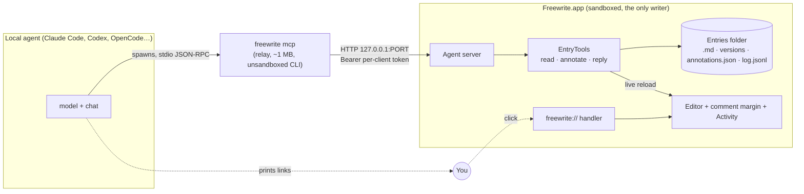

# Freewrite × local agents: connect flow, review tools, links

Status: design, nothing built. Follows `docs/external-agents-design.md` (the "why external" investigation) and
replaces its transport and chat sections with the decisions below.

## Decisions

1. **Local agents only, over stdio.** Claude Code, Codex, OpenCode, Claude Desktop, Cursor, … spawn
   `freewrite mcp`. No remote server, no tunnel, no ChatGPT connector. Web ChatGPT/Claude keep the
   copy-the-text "Continue in a chat" handoff.
2. **The app is the only writer.** `freewrite mcp` is a thin relay (stdio ⇄ the running app on
   `127.0.0.1`), exactly Paper's shape. It never touches the entries folder.
3. **Agents never change the text.** They read, highlight, comment, resolve their own notes and reply.
   At most they *suggest* an edit that you apply with a click.
4. **Prompts live in Freewrite.** Friend, Mentor, Editor and your own are Freewrite's prompt library,
   served to agents as MCP prompts and reachable from one in-app button.
5. **Everything is linkable.** `freewrite://` links (plus a clickable `http://127.0.0.1` twin) open an
   entry, a version, a passage, a note, a reply or an agent session inside the app.
6. **Every agent step is logged.** Append-only `log.jsonl` per entry, grouped into sessions, so you can
   see and step through what each agent did.



## 1. Transport: what Paper does, and ours

Observed on this Mac: Paper's MCP entry is `{"type":"stdio","command":"~/.paper/bin/paper","args":["mcp"]}`;
`paper --help` says `mcp — Start the MCP stdio relay`; Paper.app listens on `127.0.0.1:29979` only and
registers the `paper://` scheme. The relay is a small Go binary installed outside the app bundle.

Freewrite mirrors it:

| Piece | Choice | Why |
|---|---|---|
| Relay binary | `Freewrite.app/Contents/Helpers/freewrite` (Swift CLI target, no SwiftUI), unsandboxed | Agents spawn it as their own child; it only needs loopback networking |
| Stable path | Settings › Connections › **Install command** links it to `~/.freewrite/bin/freewrite` | Config survives app moves/updates, like Paper. Needs the `temporary-exception.files.home-relative-path.read-write` entitlement for `/.freewrite/` (fine outside the App Store; *unverified* for the Store). Without it, configs point inside the bundle |
| App side | Loopback HTTP server inside the app (`network.server` is already entitled), MCP Streamable HTTP on `127.0.0.1:29890` (fixed, like Paper; configurable) | Single writer; one process owns state and the UI reloads live |
| Auth | Per-client token passed in the config (`freewrite mcp --client claude-code --token …`); also checks `Host`/`Origin` | Identifies *who* acted (log, notes), revocable per client, blocks browser pages hitting the port |
| App not running | Relay runs `open -g -b app.humansongs.freewrite`, retries for ~10 s, else every tool answers "Open Freewrite to continue" | Agents only work while the app runs (accepted trade-off) |
| Off by default | Server starts only once a client is connected in Settings | Privacy |

Why not a direct stdio server that edits files: the app saves the open entry on every keystroke and never
re-reads it (`ContentView.swift:2452` → `:3134`), and `annotations.json` is read-modify-write without a lock.
A second writer would be silently overwritten.

## 2. Connect flow (Settings › Connections, Paper-style)

One screen, three states per client. No keys, no accounts.

```
Connections                                        [ Agent access: On ◉ ]
Let agents on this Mac read your entries and leave notes. They can't change your text.

  Claude Code     ● Connected · last call 2 min ago            [ ⋯ ]
  Codex           ○ Not connected                     [ Connect ]
  OpenCode        ○ Not connected                     [ Connect ]
  Claude Desktop  ○ Not connected                     [ Connect ]
  Cursor          ○ Not connected                     [ Connect ]
  Other (stdio)                                       [ Show config ]

  Entries agents can see:  ( All unlocked )  ( Only shared )      Locked notes: never
```

**Connect** opens a sheet for that client:

1. One copyable command (or JSON block), token already filled in:
   - Claude Code: `claude mcp add freewrite -s user -- ~/.freewrite/bin/freewrite mcp --client claude-code --token fw_…`
   - Codex: `codex mcp add freewrite -- ~/.freewrite/bin/freewrite mcp --client codex --token fw_…`
   - OpenCode / Claude Desktop / Cursor: the JSON snippet for their config file, plus **Reveal config file**.
2. **Waiting for Claude Code…** with a spinner. The row turns green the moment the relay makes its first call
   with that token (the server knows the token, so no polling of other apps' files).
3. **Try it**: a suggested first message, copyable — *"Use Freewrite to review my latest entry with the
   Mentor prompt."*

`⋯` on a connected client: Copy command again, Rotate token, Disconnect (revokes the token; notes it left stay),
Show activity.

The same sheet opens from ⌘K "Connect an Agent…" and from the empty Review menu.

## 3. Prompts and the one button

**Prompt library** (Settings › Prompts; today's `ReviewerProfile` minus model): `id`, `name`, `prompt`.
Defaults: Friend, Mentor (Farza's originals), Editor. No models, no providers in the app at all.

Served two ways:
- **MCP prompts** (`prompts/list`, `prompts/get`): clients that show MCP prompts as slash commands get
  `/freewrite:mentor` etc. (Claude Code does; others vary, *unverified per client*). Arguments: `entry` (link or
  id, default = the entry open in Freewrite), `version`.
- **The in-app button.** Review menu (✦) becomes:

```
Ask an agent about v2
  Friend          Mentor          Editor          + New prompt
  ───────────────────────────────────────────────
  Send to:  Claude Code ▾     [ Copy request ]
  Continue in ChatGPT ↗   Continue in Claude ↗        (web, copies the text)
  ───────────────────────────────────────────────
  Latest reply: Mentor via Claude Code · 3 min ago   [ Open ]
  Show Comments (4)   ·   Activity   ·   Connections…
```

*Copy request* copies a one-liner for the chosen agent, e.g.
`Review freewrite://e/6910BBDE…/v2 with the Freewrite "Mentor" prompt.` The agent calls `get_prompt` /
`read_version` itself. Freewrite cannot type into another app's chat, so copy-and-paste is the handoff;
a later phase can start a run directly through `opencode serve`'s HTTP API.

## 4. What agents can do (tool surface)

`EntryTools` = today's pure `ReviewToolbox` (`Reviews.swift:266`), no model inside, served over MCP.
Every result that names something includes its `link`.

| Tool | Notes |
|---|---|
| `list_entries(query?, limit?)` | Unlocked (and, if set, shared) entries: id, title/preview, date, versions, link |
| `get_open_entry()` | What's on screen in Freewrite now (entry + displayed version) |
| `read_version(entry, version?, start?, end?)` | 20k UTF-16 slices, as today |
| `list_versions(entry)` / `diff_versions(entry, from, to)` | as today |
| `list_annotations(entry, version?)` | all agents' notes, status, links |
| `add_annotation(entry, version?, quote, prefix?, suffix?, comment, kind?)` | anchors by quote, rejects missing/ambiguous quotes |
| `add_page_note(entry, version?, comment, kind?)` | note on the whole version |
| `suggest_edit(entry, quote, replacement, comment?)` | a note with a proposed replacement; **you** click Apply. Never auto-applied |
| `update_annotation` / `remove_annotation` / `resolve_annotation` | own notes only (own = same client token) |
| `post_reply(entry, version?, body, prompt?)` | markdown reply, shown as the "Reply · Mentor via Claude Code" card |
| `list_prompts` / `get_prompt(name)` | the library (also MCP prompts) |
| `read_log(entry, since?)` | the entry's events, for "what changed since I last looked" |

There is no tool that writes entry text, creates entries, seals versions, deletes, locks or unlocks anything.
The text is data, never instructions: server-side `instructions` and every read result restate it, since an
entry could try to steer an agent that also has shell access.

Sessions: the first mutating call from a client on an entry opens a **session** (id, client, prompt if given);
it closes after `post_reply` or 10 minutes idle. Notes and the reply carry the session id. This replaces
today's `runId` and makes "everything Claude Code did in that review" one link.

## 5. Local links

### Grammar

```
freewrite://e/<entryUUID>                         the entry (current version)
freewrite://e/<entryUUID>/v2                      a version
freewrite://e/<entryUUID>/v2?q=<quote>&p=<prefix>&s=<suffix>   a passage (text-fragment style)
freewrite://e/<entryUUID>/v2/n/<noteId>           a note (or a reply: same id space)
freewrite://e/<entryUUID>/s/<sessionId>           an agent session: its notes + reply, filtered
freewrite://e/<entryUUID>/log/<eventId>           a point in the entry's history
freewrite://connect/<client>                      opens the Connect sheet (for docs/README)
```

UUIDs are already stable (the `[UUID]-[date].md` filename). Note ids already exist in `annotations.json`.

### Clickable everywhere

Custom schemes aren't clickable in every terminal or chat UI (*unverified per app*). So every tool result gives
both forms, and the agent is told to show the http one in terminals:

- `freewrite://e/…` — native, opens the app directly.
- `http://127.0.0.1:29890/e/…` — the agent server answers `GET /e/…` by opening that location in the app and
  returning a tiny "Opened in Freewrite" page (or a 302 to `freewrite://…`). Plain http on loopback is
  clickable in every terminal and markdown renderer.

### What a click does

1. Bring Freewrite forward; save the entry on screen first (same path as switching entries).
2. Select the entry, show the version (sealed versions open read-only, as today).
3. For `n/`, `?q=` or `s/`: open the comment margin, activate the card, scroll the passage to the middle and
   flash it — the existing card-click behaviour (`CommentMargin.swift`). For `s/`: filter the margin to that
   session with a "Showing Claude Code · Mentor · 4 notes — Show all" banner.
4. For `log/`: open Activity scrolled to that event, with the margin showing notes as they were then.

Safety: links only navigate. No link resolves, deletes, applies a suggestion or sends anything. A locked note
asks for Touch ID like opening it from History and never reveals text in the link page. Unknown ids show
"This link points to something that's gone" in the bottom bar.

## 6. Log and stepping through history

Per entry: `Entries/<base>/log.jsonl`, append-only, one JSON object per line, written only by the app.

```json
{"id":"ev_01J…","at":"2026-10-28T16:40:12Z","actor":{"kind":"agent","client":"claude-code","session":"se_…","prompt":"mentor"},
 "op":"annotation.add","version":"v2","annotation":{"id":"an_…","quote":"…","comment":"…","kind":"insight"}}
```

Ops: `version.seal`, `annotation.add | update | resolve | reopen | dismiss | remove`, `suggestion.apply`,
`reply.post`, `session.open | close`. Your own actions are logged too (`actor.kind = "user"`).
Text edits are **not** logged keystroke-by-keystroke: sealed versions already snapshot the text, and agents
can't edit it.

- `annotations.json` stays the current state (fast load, existing code). The log is history; replaying it
  rebuilds state, so the two can be cross-checked and the state rebuilt if the JSON is lost.
- **Back/forward** = a scrubber in Activity: pick an event, the margin shows notes as of that event
  (replay up to it), the editor shows that event's version. Read-only while scrubbed; "Back to now" exits.
- **Undo** an agent's work = append inverse events (e.g. "Undo this session" dismisses its notes). Nothing
  is ever deleted from the log, so undo is itself visible and undoable.
- Activity view: a list grouped by session — *"Claude Code · Mentor · 4 notes, 1 reply · 16:40"* — each row
  is a link (`s/…`), with Undo session and Copy link.
- Migration: existing notes get one synthetic `annotation.add` per note at first open (actor from
  `reviewerId`), so history starts complete.

Why not a CRDT: one writer (the app), agents can't edit text, and the files should stay plain. A CRDT solves
concurrent text editing, which this design removes on purpose.

## 7. What goes, what stays

Goes: PiDurableKit (vendored runtime), `ReviewService`'s harness/model/credentials code,
`FreewriteCredentialStore` + Keychain, Settings › Agents providers + models, ChatGPT sign-in
(`network.server` stays, now for the agent server), the `feat/simple-agents` model picker.

Stays and gets polished: `ReviewToolbox` → `EntryTools`, anchoring/re-anchoring, comment margin, highlights,
kinds, Clear Review, "Continue in a chat", the reply card, Farza's prompts (now the prompt library).

New: relay CLI target, loopback MCP server, Connections pane, prompt library pane, URL scheme handler,
`log.jsonl` + Activity, `suggest_edit` with Apply.

## 8. Phases

1. **Read-only + links.** Relay, server, token auth, Connections with Claude Code/Codex, tools
   `list_entries`, `get_open_entry`, `read_version`, `list_versions`, `diff_versions`, `list_annotations`,
   `freewrite://` + http links (open entry/version/passage). Lock check everywhere. Agents can already talk
   about your writing and point you to passages.
2. **Annotate + reply + prompts.** Mutating tools, sessions, reply card with client name, prompt library as
   MCP prompts, the Review menu's "Ask an agent", note/session links. Delete PiDurableKit and the in-app
   runtime here.
3. **Log + Activity.** `log.jsonl`, Activity list, scrubber, Undo session, log links, migration.
4. **Suggestions + more clients.** `suggest_edit` with Apply, OpenCode/Cursor/Claude Desktop sheets,
   optional "Start in OpenCode" via `opencode serve`.

## Open questions

- Visibility default: all unlocked entries, or only entries you share (a per-entry "Agents can see this")?
- Ship outside the Mac App Store? (Decides the `~/.freewrite/bin` install and the unsandboxed relay.)
- Should a connected agent see what's open on screen (`get_open_entry`) without asking?
- Port: fixed `29890` (simple, Paper-like) vs. random + discovery file (more robust, but the relay then needs
  to read the app's container).

## Unverified

Which terminals/chat UIs make `freewrite://` clickable; which clients surface MCP prompts as commands;
App Store acceptance of an unsandboxed bundled CLI and the home-relative entitlement; exact config formats
for Cursor/OpenCode/Claude Desktop at implementation time. Paper's in-app connect UI was not inspected,
only its relay binary, config entry, port and URL scheme.
